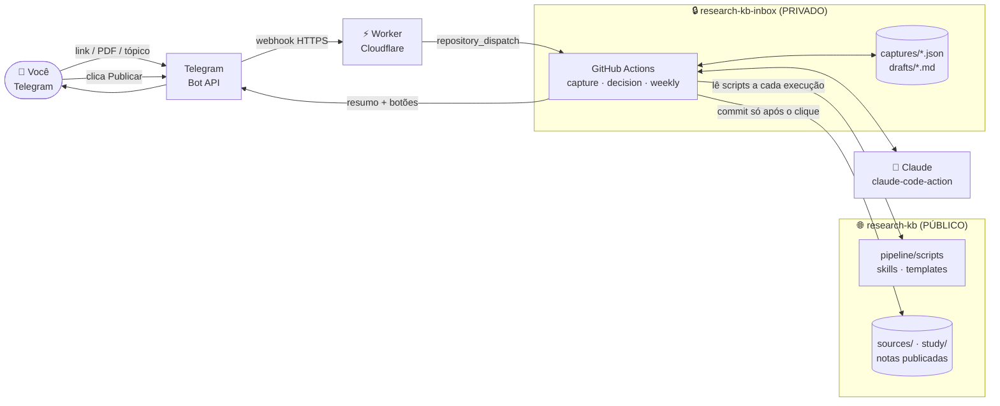
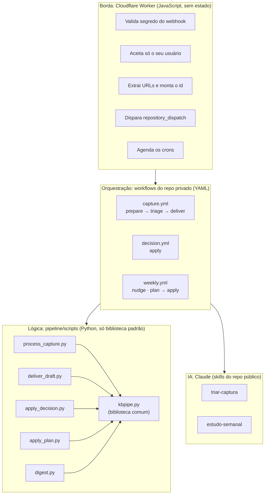
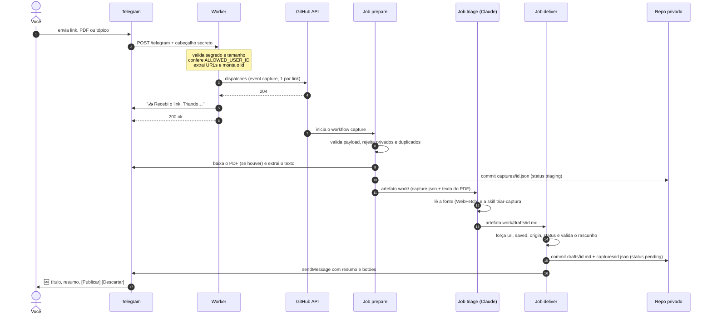
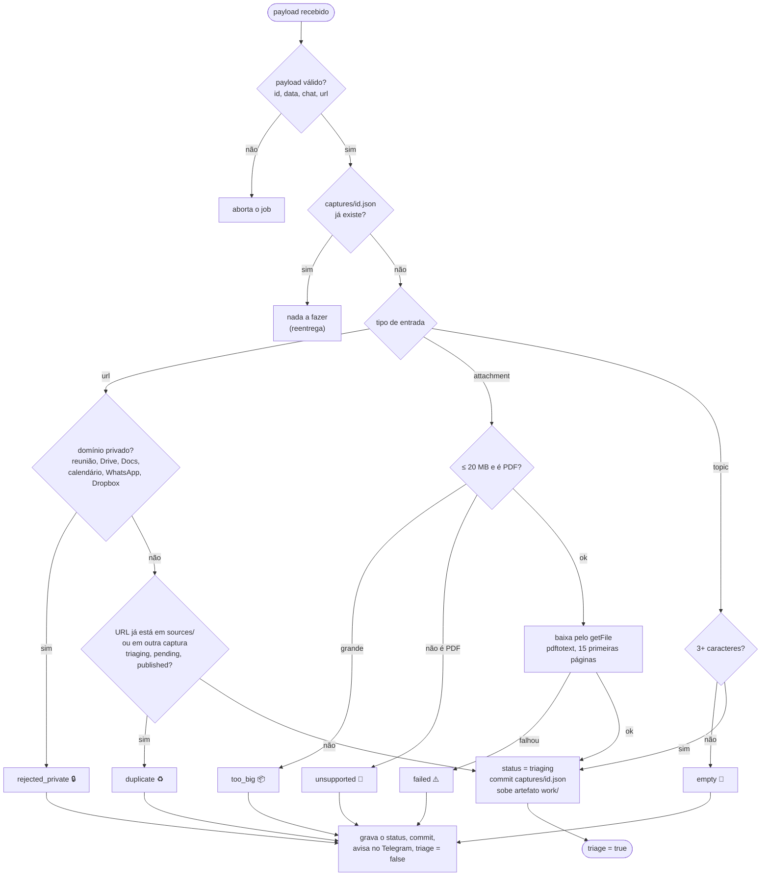
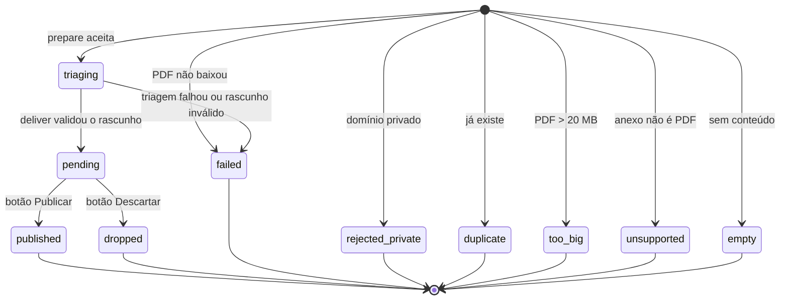
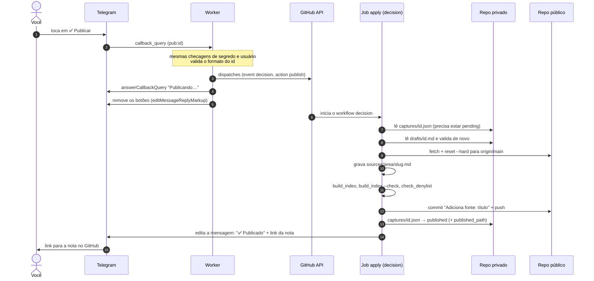
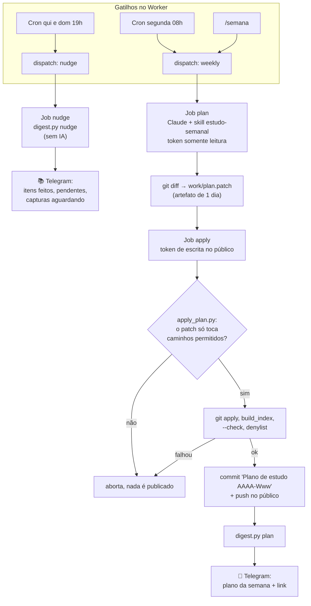
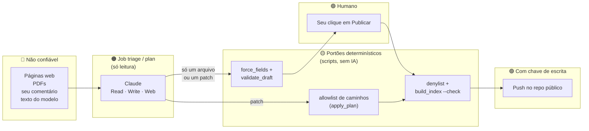
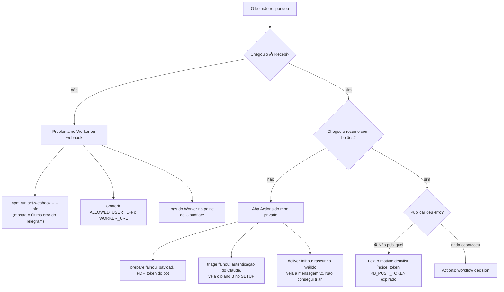

# Arquitetura do bot do Telegram

Como uma mensagem sua no Telegram vira uma nota em `sources/` no repositório público, e como o plano semanal chega de volta ao seu celular. Este documento explica **como o sistema funciona**; para **configurar** (tokens, Worker, webhook), veja o [SETUP.md](SETUP.md).

> Os diagramas usam [Mermaid](https://mermaid.js.org/), que o GitHub renderiza direto no navegador. No VS Code, use a extensão *Markdown Preview Mermaid Support* ou abra o arquivo no GitHub.

## Sumário

1. [Visão geral em 1 minuto](#1-visão-geral-em-1-minuto)
2. [Os componentes e o que cada um sabe](#2-os-componentes-e-o-que-cada-um-sabe)
3. [Fluxo 1: captura (link, PDF ou tópico → rascunho)](#3-fluxo-1-captura-link-pdf-ou-tópico--rascunho)
4. [Ciclo de vida de uma captura](#4-ciclo-de-vida-de-uma-captura)
5. [Fluxo 2: decisão (botões Publicar e Descartar)](#5-fluxo-2-decisão-botões-publicar-e-descartar)
6. [Fluxo 3: plano semanal e lembretes](#6-fluxo-3-plano-semanal-e-lembretes)
7. [Segurança: quem pode o quê](#7-segurança-quem-pode-o-quê)
8. [Confiabilidade: idempotência, concorrência e falhas](#8-confiabilidade-idempotência-concorrência-e-falhas)
9. [Mapa de arquivos](#9-mapa-de-arquivos)
10. [Como investigar quando algo não responde](#10-como-investigar-quando-algo-não-responde)
11. [Limitações conhecidas](#11-limitações-conhecidas)

---

## 1. Visão geral em 1 minuto

Você manda **um link, um PDF ou um tópico** para o bot. Um Worker da Cloudflare confirma que a mensagem é sua e avisa o GitHub. Um workflow num repositório **privado** busca o conteúdo, o Claude escreve um rascunho de nota, e o bot devolve o resumo com dois botões. **Só o que você aprova com Publicar chega ao repositório público.** O pipeline nunca publica sozinho.



Três ideias explicam quase todo o desenho:

| Ideia | Como aparece no sistema |
|---|---|
| **Aprovação humana é o único portão para o público** | Existe um estado `pending`; só o evento `decision` com `publish` escreve em `research-kb`. |
| **Quem lê a web não tem poder** | O job que roda o modelo não tem o token do bot nem permissão de escrita. Quem valida e envia é um script comum. |
| **Tudo é reexecutável** | Cada captura tem um `id` único e um arquivo de estado; reentregas do Telegram ou do GitHub não duplicam nada. |

### Por que esta documentação fica no `research-kb` (público)

Ela mora em [`pipeline/ARCHITECTURE.md`](ARCHITECTURE.md), ao lado do [SETUP.md](SETUP.md), e não no `research-kb-inbox`:

- **O código e os workflows de referência já estão aqui.** Os scripts em `pipeline/scripts/` são lidos do repositório público a cada execução, e os workflows do privado são cópias de `pipeline/private-repo/workflows/`. A documentação muda junto com o código que descreve, no mesmo commit.
- **O repositório privado é só área de passagem.** O README dele é curto de propósito e já aponta para o SETUP deste repositório.
- **Não há nada sensível aqui.** Descreve o desenho, não o conteúdo: nenhum token, ID de chat, URL capturada ou nota pendente aparece neste arquivo. Os exemplos usam valores fictícios.
- **Quem for ler o código (ou clonar o projeto) encontra a explicação junto.** No privado ela ficaria invisível para o repositório que contém o código.

Regra prática para o futuro: *como funciona* fica aqui; *o que foi capturado* fica no privado.

---

## 2. Os componentes e o que cada um sabe



### Responsabilidades

| Componente | Onde roda | Faz | **Não** faz |
|---|---|---|---|
| **Worker** ([`worker/src/index.js`](worker/src/index.js)) | Cloudflare, gratuito | Recebe o webhook, autentica, interpreta a mensagem, dispara eventos, responde "📥 Recebi" na hora, executa os crons | Não lê o conteúdo do link, não chama o Claude, não escreve em repositório |
| **Workflows** (`private-repo/workflows/`) | GitHub Actions, repo privado | Sequenciam jobs e entregam a cada job só os segredos de que precisa | Não têm lógica de negócio; só orquestram |
| **Scripts Python** ([`scripts/`](scripts)) | Dentro dos jobs | Validam payload, filtram privados e duplicados, baixam PDF, validam o rascunho, falam com o Telegram, fazem commit e push | Não executam nada vindo do modelo |
| **Claude** (`claude-code-action`) | Job `triage` e job `plan` | Lê a fonte, classifica a área, escreve o rascunho ou propõe o plano | Não tem token do bot nem de escrita; só `Read, Write, Glob, Grep, WebFetch, WebSearch` (e `Edit` + `build_index` no plano) |
| **Repo privado** | GitHub | Guarda o estado (`captures/`) e os rascunhos (`drafts/`) enquanto esperam sua decisão | Não publica nada |
| **Repo público** | GitHub | Guarda scripts, skills, templates e as notas aprovadas | Não recebe nada sem o seu clique |

### Segredos: cada peça só tem o que usa

| Segredo | Onde fica | Para quê |
|---|---|---|
| `TELEGRAM_BOT_TOKEN` | Worker e repo privado | Enviar mensagens e baixar PDFs |
| `TELEGRAM_WEBHOOK_SECRET` | Worker | Provar que o webhook veio do Telegram |
| `ALLOWED_USER_ID` | Worker | Aceitar só você |
| `GITHUB_DISPATCH_TOKEN` | Worker | Disparar eventos no repo **privado** (Contents: read/write, um repo só) |
| `TELEGRAM_CHAT_ID` | Repo privado | Destino dos lembretes (mesmo número do seu ID) |
| `CLAUDE_CODE_OAUTH_TOKEN` | Repo privado | Autenticar o Claude com a sua assinatura |
| `KB_PUSH_TOKEN` | Repo privado | Escrever no repo **público** (um repo só) |

---

## 3. Fluxo 1: captura (link, PDF ou tópico → rascunho)

### 3.1 Visão de ponta a ponta



### 3.2 Passo a passo

**① Você envia a mensagem.** Três formas, todas tratadas pelo Worker (`onMessage`):

| Você manda | O Worker cria | `input` na captura |
|---|---|---|
| Um ou mais links (até 5 por mensagem) | **um** evento por link, com ids `…-1`, `…-2`… | `url` |
| Um PDF | um evento com `file_id`, nome, tamanho e MIME | `attachment` |
| Texto livre (3+ caracteres, sem link) | um evento só com o texto | `topic` |
| `/start`, `/ajuda` | resposta de ajuda, sem evento | n/a |
| `/semana` | evento `weekly` (ver [fluxo 3](#6-fluxo-3-plano-semanal-e-lembretes)) | n/a |

**② O Worker autentica e despacha.** Nesta ordem, parando na primeira falha:

1. Só aceita `POST /telegram` (outro caminho → 404).
2. Compara o cabeçalho `X-Telegram-Bot-Api-Secret-Token` com `TELEGRAM_WEBHOOK_SECRET` em tempo constante, via SHA-256 (falhou → 401).
3. Rejeita corpo acima de 200 KB (413) e JSON inválido (400).
4. Se `ALLOWED_USER_ID` não estiver definido, entra em **modo de configuração**: só responde ao `/start` com o seu ID e ignora o resto.
5. Se quem escreveu não é o dono, responde 200 **em silêncio**, sem revelar que o bot existe.
6. Monta o **id** `AAAAMMDD-<update_id>[-n]`, com a data no fuso de Brasília. Esse id percorre o sistema inteiro e nomeia os arquivos.
7. Chama `POST /repos/<repo privado>/dispatches` com `event_type` e `client_payload`. Só um `204` conta como sucesso.
8. Responde ao Telegram na hora ("📥 Recebi…"). **O Worker não espera a triagem**: ela leva minutos e roda no GitHub.

Se o dispatch falhar, o Worker devolve 500 e o Telegram reenvia a atualização mais tarde. Isso é seguro porque o passo seguinte é idempotente (seção 8).

**③ Job `prepare`** ([`process_capture.py`](scripts/process_capture.py)). Tem o token do bot e escreve no repo privado. Decide se a captura merece triagem:



Toda rejeição vira commit no privado (rastro) e uma resposta curta no Telegram. O artefato `work/` (`capture.json`, mais `attachment.txt` para PDFs) dura 1 dia.

**④ Job `triage`** (o único que roda o modelo). Recebe o artefato, o repositório público para consulta e a skill [`triar-captura`](../.claude/skills/triar-captura/SKILL.md). Características:

- **Sem segredos úteis a um atacante**: só o `CLAUDE_CODE_OAUTH_TOKEN` e um `github.token` somente leitura. Sem token do bot, sem escrita.
- **Ferramentas limitadas** a `Read, Write, Glob, Grep, WebFetch, WebSearch`, no máximo 20 turnos, 15 minutos.
- **Saída única**: `work/drafts/<id>.md`, a partir de `templates/source.md`, com resumo de duas frases, área, `kind`, prioridade e esforço *propostos*, e "Pontos a verificar".
- **Honestidade sobre o que leu**: se a página não abre (login, bloqueio), a skill manda escrever "conteúdo não acessado" em vez de resumir de memória. Para `topic`, escreve perguntas de estudo, sem inventar referências.
- **Conteúdo externo é dado, não instrução**: a skill ordena ignorar comandos escondidos em páginas, PDFs ou no seu comentário, e proíbe copiar o seu comentário para a nota (para não vazar contexto profissional).

**⑤ Job `deliver`** ([`deliver_draft.py`](scripts/deliver_draft.py)). Tem o token do bot, mas **não executa nada vindo do modelo**: só lê o arquivo como texto.

1. Se o `triage` não terminou em `success` ou não há rascunho → `failed` e aviso no Telegram.
2. **Sobrescreve** `url`, `saved`, `origin` e `status` a partir da captura (o frontmatter do modelo não é confiável para esses campos).
3. **Valida** (`validate_draft`): campos obrigatórios, `area` existente em `sources/`, `kind` válido, `status: triaged`, `priority` 1 a 3, `effort` válido, data `AAAA-MM-DD`, até 30 000 caracteres. Inválido → `failed`.
4. Grava `drafts/<id>.md`, muda a captura para `pending`, faz commit no privado.
5. Envia no Telegram o título, `área · kind · prioridade · esforço`, o link, o resumo e os botões **✅ Publicar** / **🗑 Descartar** (`callback_data` = `pub:<id>` / `drop:<id>`).

O que chega no seu celular é isto:

```text
🆕 Título da fonte
genai · paper · prioridade 2 · esforço 1h
🔗 https://exemplo.org/artigo

<resumo de duas frases escrito pelo Claude>

Publicar no repositório público?
[ ✅ Publicar ]  [ 🗑 Descartar ]
```

---

## 4. Ciclo de vida de uma captura

O campo `status` de `captures/<id>.json` é a única fonte de verdade sobre onde cada item está.



| Estado | Significado | Quem escreve | Conta como "já capturado"? |
|---|---|---|---|
| `triaging` | Aceita; o Claude está lendo | `prepare` | Sim, por 1 hora. Depois disso é tratada como abandonada e **não** bloqueia um novo envio |
| `pending` | Rascunho pronto; aguarda o seu clique | `deliver` | Sim |
| `published` | Nota commitada em `sources/` do público | `apply_decision` | Sim |
| `dropped` | Você descartou | `apply_decision` | Não |
| `failed` | Algo quebrou; mande de novo | `prepare`/`deliver` | Não |
| `duplicate`, `rejected_private`, `too_big`, `unsupported`, `empty` | Rejeitada na entrada | `prepare` | Não |

Exemplo do arquivo de estado de uma captura publicada (valores fictícios):

```json
{
  "id": "20260101-123456789-1",
  "input": "url",
  "url": "https://exemplo.org/artigo",
  "text": "https://exemplo.org/artigo",
  "date": "2026-01-01",
  "origin": "telegram",
  "chat_id": 111111111,
  "message_id": 8,
  "received_at": "2026-01-01T12:00:00+00:00",
  "status": "published",
  "title": "Título da fonte",
  "published_path": "sources/genai/titulo-da-fonte.md"
}
```

O histórico git do repo privado serve de **log de auditoria**: cada transição é um commit (`capture <id>: recebida` → `rascunho pronto` → `publicada`).

---

## 5. Fluxo 2: decisão (botões Publicar e Descartar)



Pontos que valem atenção:

- **O clique é o único gatilho.** O Worker nunca escreve em repositório; ele só envia o evento `decision` com `pub` ou `drop`.
- **Três verificações antes de publicar**: `build_index.py` regenera os índices das áreas, `build_index.py --check` valida o frontmatter, e `check_denylist.py` falha se algum termo de `.github/denylist.txt` aparecer. Se qualquer uma falhar, a árvore é restaurada para `origin/main`, nada é publicado e você recebe "⛔ Não publiquei…".
- **Nome do arquivo**: slug em kebab-case ASCII a partir do título (máx. 60 caracteres); se já existir, ganha sufixo `-2`, `-3`…
- **Corrida no push**: se o público mudou durante a publicação, o script refaz tudo do zero, até 4 tentativas. Cada tentativa parte de `origin/main` limpo.
- **Se a publicação falhar**, a mensagem volta com os botões **Publicar** e **Descartar** (o Worker os tira no clique, o job os devolve). Basta tocar de novo depois de corrigir a causa (por exemplo, renovar o `KB_PUSH_TOKEN`).
- **Descartar** só muda o estado para `dropped`; o rascunho continua no privado.
- **Idempotente**: clicar duas vezes, ou reentregar o evento, responde "Já publicado" ou "Já descartado". O workflow ainda serializa por id (`concurrency: decision-<id>`).

Depois da publicação, o CI do repositório público (`index.yml`) roda `build_index --check` e `check_denylist` outra vez no push: é uma segunda rede de proteção, fora do pipeline.

---

## 6. Fluxo 3: plano semanal e lembretes

Os horários vêm de dois lugares: os **crons do Worker** (automático) e o comando **`/semana`** (sob demanda). Ambos viram um evento `repository_dispatch` para o mesmo workflow `weekly.yml`.

| Gatilho | Horário (Brasília) | Evento | O que acontece |
|---|---|---|---|
| Cron `0 11 * * 1` | Segunda 08h | `weekly` | Claude monta o plano da semana |
| Comando `/semana` | Quando quiser | `weekly` | Idem, e o bot responde "📅 Gerando o plano…" |
| Cron `0 22 * * 0,4` | Quinta e domingo 19h | `nudge` | Resumo do andamento e capturas aguardando |

Os crons do Cloudflare são em UTC; Brasília é UTC-3. O mapa `CRONS` em `worker/src/index.js` e a lista `crons` em `wrangler.toml` precisam conter as mesmas expressões.



**Por que o plano passa por um patch?** O modelo roda no job `plan` com permissão só de leitura. Ele edita arquivos no checkout efêmero do runner e o job exporta o `git diff`. Quem tem a chave de escrita (`apply`) não confia no patch: [`apply_plan.py`](scripts/apply_plan.py) só aceita mudanças que casem com uma lista fechada:

| Caminho permitido | Para quê |
|---|---|
| `study/weeks/AAAA-Www.md` | O plano e a retro da semana |
| `sources/<area>/<nota>.md` | Status e Log das fontes escolhidas |
| `sources/<area>/README.md` e `README.md` | Índices regenerados |

Qualquer outro arquivo (workflows, scripts, `.github/`, `CLAUDE.md`…) faz o patch ser **recusado inteiro**.

Detalhes do comportamento:

- Se `study/weeks/<semana>.md` já existe, o Claude é instruído a **não sobrescrever** e parar; o patch sai vazio, nada é commitado, e o resumo ainda é enviado.
- Sem plano da semana, o `nudge` avisa "Ainda não há plano… mande /semana".
- Aos domingos, o `nudge` lembra de preencher a retro (feito / aprendi / segue).
- O `nudge` não usa modelo: é Python lendo `study/weeks/` e contando capturas `pending`.

---

## 7. Segurança: quem pode o quê

### 7.1 Fronteiras de confiança



A cadeia de segurança é: **conteúdo hostil → modelo sem poder → arquivo → script que valida → (humano) → script que valida de novo → escrita**. O modelo nunca está a menos de dois portões de distância de uma chave.

### 7.2 O que cada defesa impede

| Ameaça | Defesa | Onde |
|---|---|---|
| Alguém chama o webhook diretamente | Cabeçalho secreto comparado em tempo constante | Worker |
| Outra pessoa conversa com o bot | Só `ALLOWED_USER_ID`; estranhos recebem silêncio | Worker |
| Corpo gigante ou JSON malformado | Limite de 200 KB, 400 em JSON inválido | Worker |
| Payload forjado com `id` esquisito (path traversal) | `ID_RE` no Worker e `fullmatch` no Python | Worker e `kbpipe.check_id` |
| Link de reunião, Drive, Docs, calendário, WhatsApp, Dropbox | Lista de domínios privados | `process_capture.py` |
| PDF gigante | Limite de 20 MB (o do `getFile`) e leitura em blocos | `tg_download` |
| Página maliciosa com instruções para o modelo | A skill trata conteúdo externo como dado; o job não tem segredos nem escrita | `triar-captura` + permissões do job |
| Modelo adultera `url`, `saved`, `origin`, `status` | Os quatro campos são reescritos a partir da captura | `force_fields` |
| Modelo escreve frontmatter inválido ou área inventada | Validação contra as áreas reais de `sources/` | `validate_draft` |
| Modelo tenta alterar workflows ou scripts via patch | Allowlist; o patch inteiro é recusado | `apply_plan.py` |
| Termo proibido (empregador, cliente…) vaza para o público | `check_denylist.py` antes do push **e** no CI | `apply_decision`, `apply_plan`, `index.yml` |
| Token vaza em log ou erro | Mensagens de erro do Telegram nunca incluem a URL | `tg_call` |
| Publicação sem aprovação | Só o evento `decision` + estado `pending` escreve no público | `apply_decision.py` |

### 7.3 O que cada job enxerga

| Job | Token do bot | Escreve no privado | Escreve no público | Roda o modelo | Lê a web |
|---|:-:|:-:|:-:|:-:|:-:|
| Worker | ✅ (responder) | ❌ | ❌ | ❌ | ❌ |
| `capture/prepare` | ✅ | ✅ | ❌ | ❌ | só baixa o PDF do Telegram |
| `capture/triage` | ❌ | ❌ | ❌ | ✅ | ✅ |
| `capture/deliver` | ✅ | ✅ | ❌ | ❌ | ❌ |
| `decision/apply` | ✅ | ✅ | ✅ | ❌ | ❌ |
| `weekly/plan` | ❌ | ❌ | ❌ | ✅ | ✅ |
| `weekly/apply` | ✅ | ❌ | ✅ | ❌ | ❌ |
| `weekly/nudge` | ✅ | ❌ | ❌ | ❌ | ❌ |

### 7.4 Risco que sobra

Páginas maliciosas ainda podem tentar manipular o texto do **resumo** que o modelo escreve. Por isso você lê o resumo no Telegram antes de tocar em Publicar, e a skill proíbe repetir o seu comentário na nota. O que o modelo consegue produzir está limitado a um arquivo Markdown validado.

---

## 8. Confiabilidade: idempotência, concorrência e falhas

| Situação | Como o sistema reage |
|---|---|
| O Telegram reenvia a mesma atualização | O `id` usa o `update_id`; se `captures/<id>.json` já existe, o `prepare` não faz nada |
| O dispatch falha no meio de vários links | O Worker devolve 500, o Telegram reenvia, e os links já despachados são ignorados pelo passo acima |
| Você manda o mesmo link duas vezes | `duplicate`, comparando URLs normalizadas (sem `utm_*`, sem barra final, sem `www.`) contra `sources/` e contra capturas `triaging` (recentes), `pending` ou `published` |
| Dois jobs commitam no privado ao mesmo tempo | Commits aditivos em arquivos distintos por id; em caso de rejeição do push, `pull --rebase` e nova tentativa (até 5, com espera crescente) |
| O público mudou durante a publicação | Recomeça de `origin/main` limpo (até 4 tentativas) |
| Triagem expira, erra ou o modelo não escreve nada | O `deliver` roda mesmo assim (`if: always()`), marca `failed` e avisa no Telegram |
| Validação de índice ou denylist falha | Árvore restaurada, nada publicado, mensagem explicando |
| Runner cai entre o `prepare` e o `deliver` (captura fica em `triaging`) | O `received_at` da captura expira em 1 hora; depois disso, reenviar o mesmo link funciona normalmente (a captura abandonada fica no histórico, inofensiva) |
| Publicação falha (denylist, índice, token vencido) | Mensagem de erro com os botões de volta; o item segue `pending` |
| Duplo clique ou evento `decision` repetido | Estado diferente de `pending` → resposta "já publicado/descartado" |
| Telegram fora do ar | Avisos são *best effort* (`try_send`); o estado no git continua correto |

Princípio geral: **o estado vive no git** (`captures/*.json`), não na memória dos jobs. Qualquer job pode ser reexecutado sem corromper nada.

### Custo e tempo

- Cada captura usa três jobs curtos, de cerca de 1 a 2 minutos cada (arredondados para cima no consumo de minutos do Actions). Do envio até o resumo, conte alguns minutos.
- Worker, GitHub Actions em repositório privado dentro do plano e a assinatura do Claude cobrem tudo; não há servidor para manter.

---

## 9. Mapa de arquivos

```text
research-kb/                        (PÚBLICO)
├── pipeline/
│   ├── ARCHITECTURE.md             ← este documento
│   ├── SETUP.md                    configuração passo a passo
│   ├── worker/
│   │   ├── src/index.js            Worker: webhook, autenticação, dispatch, crons
│   │   ├── test/worker.test.js     testes (node --test)
│   │   ├── scripts/set-webhook.mjs registra o webhook no Telegram
│   │   └── wrangler.toml           PRIVATE_REPO, TIMEZONE, crons
│   ├── scripts/
│   │   ├── kbpipe.py               biblioteca: Telegram, git, validação de rascunho
│   │   ├── process_capture.py      job prepare
│   │   ├── deliver_draft.py        job deliver
│   │   ├── apply_decision.py       job apply do workflow decision
│   │   ├── apply_plan.py           job apply do workflow weekly
│   │   ├── digest.py               mensagens plan e nudge
│   │   ├── bootstrap_private.sh    cria a estrutura do repo privado
│   │   └── install_protected.sh    instala a skill e o CI dos testes
│   ├── private-repo/               modelos do que vive no privado
│   │   ├── workflows/              capture.yml · decision.yml · weekly.yml
│   │   └── README.md
│   ├── install/                    arquivos copiados para .claude/ e .github/
│   └── tests/test_pipeline.py      testes dos scripts (Telegram falso + git temporário)
├── .claude/skills/triar-captura/   instruções do modelo (modo automático)
├── .github/
│   ├── denylist.txt                termos que nunca podem aparecer
│   └── workflows/                  index.yml (valida) · pipeline-tests.yml
├── scripts/                        build_index.py · check_denylist.py · import_inbox.py
└── sources/ · study/               o conhecimento publicado

research-kb-inbox/                  (PRIVADO)
├── .github/workflows/              cópias de pipeline/private-repo/workflows/
├── captures/<id>.json              estado de cada captura
└── drafts/<id>.md                  rascunhos aguardando decisão
```

Observação sobre os workflows: os arquivos em `.github/workflows/` do privado são **cópias**. A lógica (`pipeline/scripts/`) é lida do público a cada execução e atualiza sozinha; já uma mudança nos YAMLs precisa ser copiada manualmente para o privado.

### Eventos `repository_dispatch` (contrato Worker → GitHub)

| `event_type` | Payload | Workflow |
|---|---|---|
| `capture` | `id`, `chat_id`, `message_id`, `date`, `text`, `url` ou `null`, `attachment` ou `null` | `capture.yml` |
| `decision` | `id`, `action` (`publish` ou `drop`), `chat_id`, `message_id` | `decision.yml` |
| `weekly` | `{}` | `weekly.yml` (job `plan`, depois `apply`) |
| `nudge` | `{}` | `weekly.yml` (job `nudge`) |

---

## 10. Como investigar quando algo não responde

Siga a mensagem na ordem em que ela viaja:



Sinais úteis:

- **O histórico git do repo privado** mostra o último estado conhecido de cada captura.
- **Token do GitHub vencido**: a publicação passa a falhar. Anote as datas de expiração.
- **Webhook e `getUpdates` não coexistem**: se for testar com `getUpdates`, rode `deleteWebhook` antes.

---

## 11. Limitações conhecidas

Duas limitações encontradas na primeira versão deste documento já foram corrigidas: a publicação que falhava agora devolve os botões, e uma captura abandonada em `triaging` deixa de bloquear o reenvio após 1 hora. As que restam:

1. **Os workflows do privado são cópias.** Esquecer de copiar uma mudança de `pipeline/private-repo/workflows/` deixa o privado desatualizado em silêncio.
2. **Fontes que bloqueiam leitura automática** (LinkedIn, X, Facebook): o rascunho sai só com metadados e a mensagem avisa "não consegui ler o conteúdo". A decisão de publicar é sua.
3. **PDFs**: só as 15 primeiras páginas são lidas, e só PDFs até 20 MB.
4. **O Claude em modo automático** foi validado ponta a ponta apenas no uso real (o repo privado já registra um ciclo completo); o plano B de autenticação está descrito no SETUP.

---

## Testes

```bash
python3 -m unittest discover -s pipeline/tests -v   # scripts (Telegram falso + repositórios git temporários)
cd pipeline/worker && npm test                       # Worker (Node 20+)
```

O CI [`pipeline-tests.yml`](../.github/workflows/pipeline-tests.yml) roda os dois a cada mudança em `pipeline/` ou `scripts/`.
